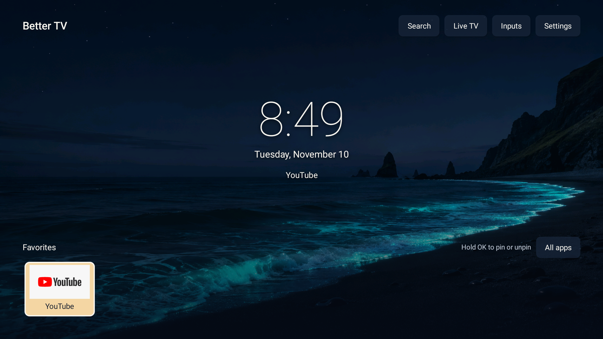
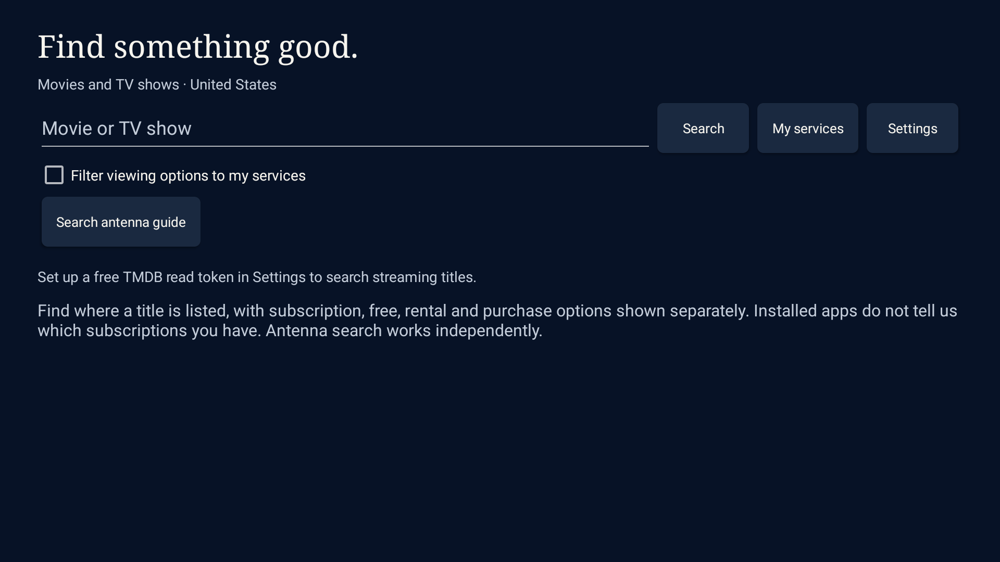

# Better TV

A small, native Android TV home screen with a Gallery layout, randomized bundled artwork, favorite apps, universal title search, and access to the TV's existing live-TV, HDMI, and settings screens. The first target is a US TCL 50QM5K running Google TV / Android TV OS 12.

This is a launcher APK. Streaming, decoding, DRM, tuner controls, casting, updates, and picture/sound settings remain with the TV's existing software and apps. There is no firmware image to flash.

The current development version is **0.2.1**. Build the APK locally with the instructions below; generated APKs and development signing keys are not stored in this repository. ZIP defaults to **54650** unless you have saved another value. See [search setup](docs/search-setup.md) for the required personal TMDB token and the limits of antenna-guide access. First-build results are recorded in [docs/verification.md](docs/verification.md), and the Home-button diagnosis/update is in [docs/home-fix.md](docs/home-fix.md).

Actual Android TV 12 emulator screenshots:





The Gallery/search feature validation is recorded in [version 0.2.0 verification](docs/verification-0.2.0.md), with the ZIP-default patch recorded in [version 0.2.1 verification](docs/verification-0.2.1.md).

## Features

- Gallery clock/date, three original bundled landscapes, and clear D-pad focus. A different static image is chosen when returning Home or selecting New background.
- Discovers actual installed TV apps, including services beyond the initial favorites.
- Long-press an app to pin or unpin it; favorites stay on the TV.
- An All apps drawer and a compact favorite dock. No fabricated movie recommendations or viewing history.
- Movie/TV search, posters, US streaming offers, season selection, and a persistent My-services filter. Live streaming search requires your own TMDB API Read Access Token.
- Optional read-only antenna-guide search over listings the TV already shares. ZIP can be saved, but does not download schedules or configure the tuner.
- Shortcuts to the installed live-TV app, available HDMI inputs, and Android settings.
- An optional request to become the Home app where the TV exposes that choice.
- An optional Home-button fix, enabled by the user in Android Accessibility settings, for TVs that keep opening the stock home screen despite the Home role.
- No advertising, analytics, autoplay, or wallpaper feed. Search makes HTTPS requests on demand; local TV-guide access is requested only when used. No streaming-service passwords are requested.

The exact TCL model is not needed to begin development. It will help investigate OEM-specific Home-button, startup, antenna, and input behavior. Android version and firmware build identifiers do not uniquely establish those behaviors.

## Build on Windows

Prerequisites: JDK 17+, Android SDK platform 35 and build-tools 35.0.0. Android Studio can install these. The project also supports workspace-local tools in `.tools`; it does not change the system PATH or install global software.

If those prerequisites are missing, `scripts/setup-android.ps1` downloads verified official tools into `.tools` and accepts the Android SDK development licenses. Node.js is used for HTTPS downloads when available. The SDK, emulator, and Gradle caches take several GB; they are excluded from source control.

```powershell
.\build.ps1
```

The Gradle wrapper pins the Gradle version; the build files select the Android plugin and SDK. The command runs the assert-based core/manifest checks, assembles the APK, and runs Android lint. The APK is written to `app/build/outputs/apk/debug/app-debug.apk`. This is a development build for local testing. See the script for local tool discovery and alternate Gradle tasks.

## Try it on the TV

Start by installing and opening Better TV as a normal app. Test navigation and playback before choosing it as your Home app.

### USB stick

1. Copy the APK to a USB stick and connect it to the TV.
2. Open it with a trusted file manager already available on the TV. If needed, Android may ask you to allow that particular file manager to install unknown apps. Turn that allowance off afterward.
3. Install Better TV, then open it from the TV's Apps screen.

USB app installation depends on the TV's file manager and policy. **Do not use recovery mode, “Apply update from USB,” or a firmware-update menu for an APK.**

### ADB, when debugging is already configured

Use the TV's own developer/debugging screen to establish a connection from a PC you trust. The TV may require a pairing step, a displayed port, or an on-screen authorization. Do not assume a particular network-debugging port works on every model.

```powershell
adb devices
adb -s <your-tv-device-id> install -r .\app\build\outputs\apk\debug\app-debug.apk
adb -s <your-tv-device-id> shell am start -n com.bettertv.launcher/.MainActivity
```

The explicit device ID prevents accidentally installing on another connected Android device. Turn off network debugging when testing is finished.

## Check on the TCL

1. Compare the original home screen with Better TV after each has been opened once. Compare remote response, time to a usable home screen, and return from a streaming app. A shorter animation is not proof that app startup or playback improved.
2. Open each service you use: Prime Video, Apple TV, YouTube, Hulu, Disney+, ESPN, Paramount+, Netflix, and any others discovered on the TV. Check login, playback, HDR/audio, Back, and return to Home.
3. Pin/unpin an app from the dock or All apps drawer; reopen Better TV and verify the selection persists. Check navigation using only the D-pad, Select, Back, and long-press Select. Returning Home should select a different bundled background.
4. Open antenna TV and an Xbox HDMI input. If the TV does not expose a working shortcut, use the original remote's TV/Input control and record the model/firmware so the integration can be adjusted.
5. Test casting from a phone while Better TV is visible. The launcher leaves the existing receiver in place; that is a design boundary, not a hardware verification.
6. If all of those work, try the optional default-Home request. Check Home from an app, standby/wake, and a full restart. OEM software can handle these differently.
7. Set up your TMDB read token and selected services following [search setup](docs/search-setup.md). Verify live title search, season offers, My-services on/off, and provider app shortcuts. Antenna-guide access should prompt only on use and handle denial or unavailable guide data clearly.

AirPlay is separate from Google Cast. This launcher does not add an AirPlay receiver; support needs checking on the actual TCL model.

## Home button and rollback

### If selecting Home still opens Google TV

Version 0.1.1 adds **Better TV → Settings → Home button fix**. This opens an explanation and a link to Android Accessibility settings. Enable **Better TV Home button fix** there only if you want this workaround. Android may display its standard accessibility warning.

The service receives window-state events only from discovered, exported system Home activities; it opens Better TV when one of those exact Home activities appears. It does not request key filtering, screen-content retrieval, screenshots, or network access. Google TV may flash briefly before redirecting. Opening the original home screen manually also redirects while the service is enabled; switch the service off in Accessibility settings to restore normal access. TV settings and other activities remain accessible.

Being listed as Android's Home-role holder does not guarantee that Android resolves Home to this app: the Android TV 12 emulator reproduced Google TV retaining a higher Home-intent priority. The previous “already your home screen” message overstated this; it now explains that the Home-button fix may still be needed. Real TCL boot/standby behavior still needs testing even with this workaround.

If the Accessibility switch turns off after Restart, first check the TV's **Safety Guard → Permission Shield** for a per-app **Auto Launch Permission** and **Relevance Start Permission** allowance for Better TV. These controls vary by firmware and are not present on all TCL TVs. See [the startup diagnosis and sources](docs/home-fix.md#tcl-service-disabled-after-restart). Changing Home-window timing in the APK cannot help while Android has the service disabled.

### Rollback

Disable **Better TV Home button fix** in Android Accessibility settings if enabled. During the initial normal-app test, pressing Home still uses the existing default launcher. If you later choose Better TV as the default, use Android's default-home settings to select the original home app. If the TV does not offer that setting, uninstall Better TV through Settings → Apps, or use the already-authorized ADB connection:

```powershell
adb -s <your-tv-device-id> uninstall com.bettertv.launcher
```

This project does not disable, uninstall, or clear data from the original launcher, streaming apps, setup components, or casting services. No factory reset is part of installation or rollback.

## Compatibility boundaries

The app targets Android TV / Google TV devices rather than a single TCL model. It does not promise identical behavior on every OEM's firmware. Home selection, boot/wake routing, tuner handoff, and HDMI handoff require a real-device test.

Live title search and watch-provider data come from TMDB/JustWatch, rather than private streaming accounts. Coverage may be incomplete or stale, and the app does not verify subscription entitlement. TMDB's provider endpoints do not return full title-level playback links; buttons launch the provider app and say so. Watchlists and Continue Watching remain outside this version. Antenna results depend on the TV exposing its cached terrestrial guide; a saved ZIP is not a licensed local-lineup lookup.

Useful primary references:

- [Android TV application setup and remote navigation](https://developer.android.com/training/tv/get-started/create)
- [Narrow package-visibility declarations](https://developer.android.com/training/package-visibility/declaring)
- [Android Home role](https://developer.android.com/reference/android/app/role/RoleManager)
- [TV input framework](https://source.android.com/docs/devices/tv)
- [TV passthrough-input URIs](https://developer.android.com/reference/android/media/tv/TvContract#buildChannelUriForPassthroughInput%28java.lang.String%29)
- [Watch Next publishing](https://developer.android.com/training/tv/discovery/watch-next-add-programs)
- [TCL's model-specific USB recovery guidance](https://support.tcl.com/en_US/how-to-troubleshoot-a-tcl-google-tv-in-recovery-mode)

Artwork provenance and exact generation prompts are in [docs/artwork.md](docs/artwork.md) and [docs/gallery-artwork.md](docs/gallery-artwork.md).
